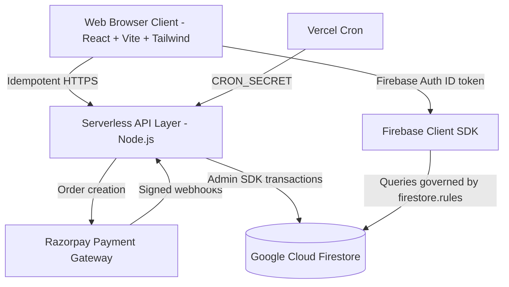

# VERNOX ARCHITECTURE SPECIFICATION

## 1. System Overview
Vernox is a luxury e-commerce platform and bespoke CAD/CAM architectural signage configurator engineered for high-concurrency, resilience, and cryptographic payment verification.

## 2. Technology Stack
- **Frontend Framework**: React 18 with TypeScript, Tailwind CSS, Lucide icons, and Sonner notifications.
- **CAD/CAM Vector Engine**: Custom in-browser computational geometry engine (`cadEngineTypes.ts`, `imageTracer.ts`, `manufacturingRules.ts`) enabling client-side kerf offset and DXF export.
- **Serverless API Layer**: Vercel Node.js functions in `api/` (`checkout-intent`, `verify-payment`, `validate-coupon`, `order-status`, `razorpay-webhook`, `admin`, `cron/release-reservations`). Shared code in `api/_lib/`: pure domain logic (`pricing`, `coupons`, `orderLifecycle`) separated from I/O (`checkout`, `payments`, `webhook`, `reservations`) via the `DocStore` port (`store.ts`; Firestore Admin SDK in production, in-memory in tests). `server/index.ts` serves the same handlers for Docker.
- **Database**: Google Cloud Firestore (multi-region distributed document store with document-level ACID transactions).
- **Authentication**: Firebase Authentication. Staff roles are custom claims (`role`) set only by the server; permissions are defined once in `src/types/admin.ts` and enforced by `/api/admin` and mirrored in `firestore.rules`.
- **Payment Gateway**: Razorpay with cryptographic HMAC-SHA256 signature verification and idempotent webhook/callback processing.

## 3. Server-Authoritative Domains
- **Pricing** (`api/_lib/pricing.ts`): catalog prices from Firestore `products`; custom studio pieces from dimensions × per-finish
  rate (`settings/store.customPieces`, defaults in `api/_lib/storeConfig.ts`); GST and shipping from `settings/store` with env
  defaults. Integer paise internally. Client prices are display-only and never accepted.
- **Coupons** (`api/_lib/coupons.ts`): evaluated only from Firestore against server-priced lines; redeemed atomically when the
  order is paid.
- **Inventory**: reserved with atomic increments in the transaction that creates the order (`api/_lib/checkout.ts`), released on
  payment failure, provider failure or expiry (cron every 5 min), re-taken on late payment.
- **Order lifecycle** (`api/_lib/orderLifecycle.ts`): `Pending_Payment` (15-min reservation) → `Paid` (checkout callback or
  webhook, whichever comes first; the other is a no-op) → `Designing` → `Cutting` → `Finished` → `Shipped` → `Delivered`; side
  states `Payment_Failed`, `Expired`, `Cancelled`, `Payment_Discrepancy`, `Partially_Refunded`, `Refunded`.

## 4. Concurrency
- **Stateless app tier**: no state in function memory; rate limits and idempotency live in Firestore.
- **Transactions**: each state change re-reads the order inside a Firestore transaction and decides from its current status, so
  duplicate and out-of-order callbacks/webhooks are safe. Stock is never written from a stale snapshot.
